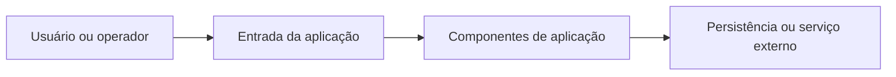

# Arquitetura — FoodBridge-Core-Supabase

**Tecnologias:** Supabase, PostgreSQL, Deno.

**Referências para inspeção:** supabase/migrations; supabase/functions; .github/workflows.

## Critérios de evolução
1. Preservar responsabilidades existentes e modularizar integrações.
2. Configurar ambientes sem credenciais no Git.
3. Validar dados e permissões no ponto de entrada adequado.
4. Testar unidade, integração e fluxo fim a fim separadamente.

**Observação:** diagrama conceitual. Não representa todos os componentes implementados nem confirma um deploy em execução.
